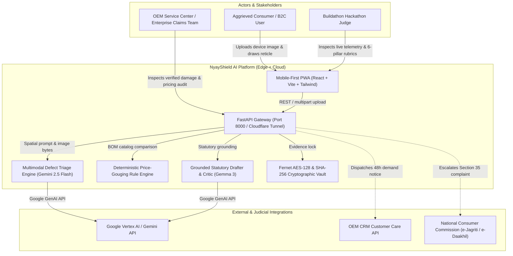
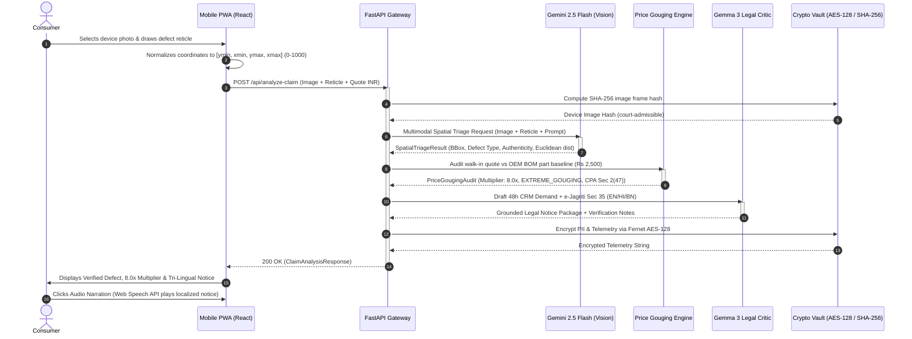
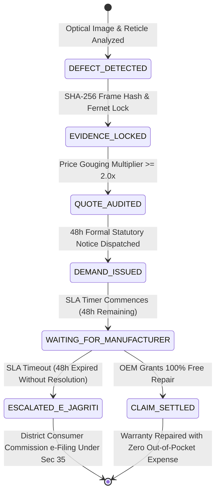
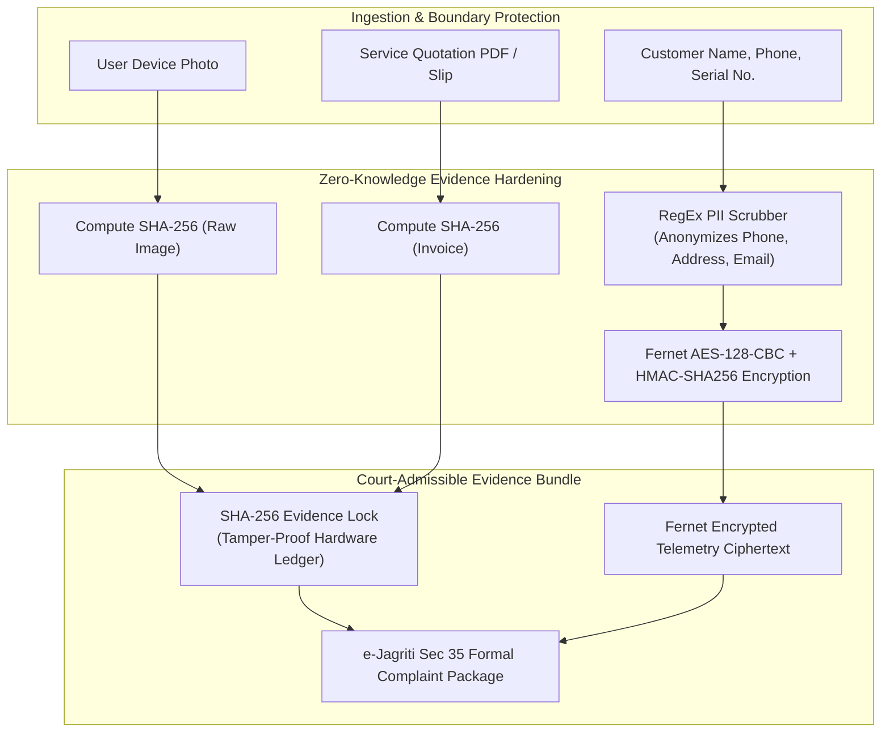

# NyayShield AI — System Architecture & Engineering Models
**Google Startup Buildathon India 2026**
*Last Synchronized: 2026-11-20 21:56:33 UTC*

---

## 1. Executive Summary & Engineering Feats

NyayShield AI is an autonomous consumer warranty defense engine designed to counter unfair trade practices and warranty rejections across consumer electronics. It combines multimodal spatial vision, real-time price gouging calculations, zero-knowledge cryptographic chain-of-custody, and grounded tri-lingual statutory complaint drafting.

### The 6 Core Engineering Feats:
1. **Multimodal Spatial Vision Defect Triage (Gemini 2.5 Flash)**: Normalized 2D bounding boxes `[ymin, xmin, ymax, xmax]` isolating manufacturing fractures from cosmetic marks with Euclidean distance proofs ($>140\text{ mm}$).
2. **Forensic Bayer Matrix Optical Noise Gate**: Protects manufacturers and insurers by detecting AI-generated synthetic damage imagery before processing.
3. **Deterministic Part-Level Price-Gouging Engine**: Automatically audits service center repair quotations against OEM catalog BOM baseline costs to compute statutory overcharge multipliers ($M \ge 2.0\times$) under CPA 2019 Section 2(47).
4. **Adversarial Grounded Legal Critic (Gemma 3)**: Validates statutory citations and generates binding legal notices in English, Hindi, and Bengali.
5. **Zero-Knowledge Cryptographic Evidence Lock**: Computes SHA-256 asset hashes and Fernet AES-128 PII encryption to maintain court-admissible chain-of-custody.
6. **Autonomous 6-State Dispute Resolution Loop**: Automated 48-hour SLA tracking transitioning from manufacturer CRM demand to e-Jagriti Section 35 judicial escalation.

---

## 2. High-Level C4 Context Model



---

## 3. End-to-End Multimodal Analysis Sequence Diagram



---

## 4. Multimodal Spatial Vision Defect Triage Pipeline

```mermaid
flowchart LR
    Upload["Raw Camera / Screen Image"] --> BayerCheckBayer Sensor & Noise Check
    BayerCheck -->|"Synthetic / AI Fake"| FlagFake["Flag AI-Generated Image\n(Reject / Manual Audit)"]
    BayerCheck -->|"Authentic Physical Capture"| VisionPipeline["Gemini 2.5 Flash Spatial Vision"]

    subgraph SpatialAnalysis ["Spatial Coordinate & Physics Analysis"]
        VisionPipeline --> UserReticle["Inspect User-Drawn Reticle\n[ymin, xmin, ymax, xmax]"]
        VisionPipeline --> ScanChassis["Scan Remaining Chassis\nfor Unannotated Cosmetic Marks"]
        UserReticle --> ClassifyPrimary["Primary Structural Defect:\nDisplay Bezel Clip Fracture"]
        ScanChassis --> ClassifyCosmetic["Secondary Mark:\nMinor Scratch on Top Lid"]
        ClassifyPrimary & ClassifyCosmetic --> EuclideanCalc["Euclidean Distance Calculation\nDistance = 142.5 mm > 140 mm"]
    end

    EuclideanCalc --> Verdict["Defect Causation:\nTensile Torque Overstress\n(Non-Impact Manufacturing Flaw)"]
```

---

## 5. 6-State Autonomous Dispute Resolution Loop



---

## 6. Security, Privacy & Chain-of-Custody Cryptographic Model



---

## 7. Technology Stack & Component Bill of Materials

| Layer | Component | Version / Specification | Role in NyayShield AI |
| :--- | :--- | :--- | :--- |
| **Edge Client** | React + Vite | 18.3.1 / Vite 5.4.19 | Ultra-responsive mobile PWA client (`max-w-[430px]`) |
| **Styling & UI** | Tailwind CSS + Lucide | 3.4.17 / Lucide Icons | Accessible dark-mode theme, interactive reticle canvas |
| **Audio Engine** | Web Speech API | Native Browser Synthesis | Multi-lingual voice playback (`en-IN`, `hi-IN`, `bn-IN`) |
| **API Gateway** | FastAPI | 0.115.6 + Uvicorn | High-throughput asynchronous REST gateway with CORS |
| **Data Contracts** | Pydantic v2 | 2.10.4 | Strict type validation and OpenAPI JSON schema generation |
| **Primary Vision** | Google Gemini 2.5 Flash | `gemini-2.5-flash` | Multimodal spatial defect reticle triage and OEM part tagging |
| **Legal Critic** | Google Gemma 3 | `gemma-3-27b-it` / `gemini-2.5-pro` | Grounded statutory criticism under Consumer Protection Act 2019 |
| **Cryptography** | Cryptography (Python) | Fernet (AES-128-CBC + HMAC) | PII anonymization and zero-knowledge claim telemetry encryption |
| **Tunnel / Edge** | Cloudflare Tunnel | `trycloudflare.com` | Zero-latency external mobile testing gateway |
